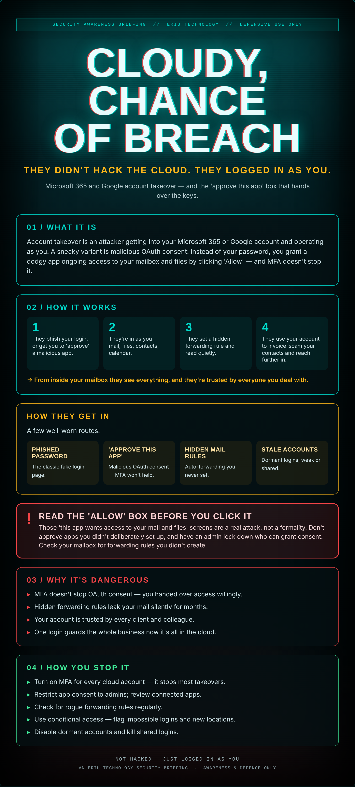

## One login guards the lot

Your business lives in the cloud now — mail, files, calendars, the lot. Which means the lock on the whole business is one login.

An attacker doesn't need to breach Microsoft. They just need to be you: a phished password, or a slick 'approve this app to continue' screen you clicked through without reading. Now there's a quiet rule forwarding your mail to them, and you've no idea.

The cloud didn't fail. The front door did — and the front door is a single sign-in.

## What it actually is

Account takeover is an attacker getting into your Microsoft 365 or Google account and operating as you. A sneaky variant is malicious OAuth consent: instead of your password, you grant a dodgy app ongoing access to your mailbox and files by clicking 'Allow' — and MFA doesn't stop it.

## How it works

1. They phish your login, or get you to 'approve' a malicious app.
2. They're in as you — mail, files, contacts, calendar.
3. They set a hidden forwarding rule and read quietly.
4. They use your account to invoice-scam your contacts and reach further in.

→ From inside your mailbox they see everything, and they're trusted by everyone you deal with.

## How they get in

A few well-worn routes:

- **Phished password** — The classic fake login page.
- **'Approve this app'** — Malicious OAuth consent — MFA won't help.
- **Hidden mail rules** — Auto-forwarding you never set.
- **Stale accounts** — Dormant logins, weak or shared.

## ⚠ Read the 'Allow' box before you click it

Those 'this app wants access to your mail and files' screens are a real attack, not a formality. Don't approve apps you didn't deliberately set up, and have an admin lock down who can grant consent. Check your mailbox for forwarding rules you didn't create.

## Why it's dangerous

- **MFA doesn't stop OAuth consent** — you handed over access willingly.
- **Hidden forwarding rules** leak your mail silently for months.
- **Your account is trusted** by every client and colleague.
- **One login guards the whole business** now it's all in the cloud.

## How you stop it

- **Turn on MFA** for every cloud account — it stops most takeovers.
- **Restrict app consent** to admins; review connected apps.
- **Check for rogue forwarding rules** regularly.
- **Use conditional access** — flag impossible logins and new locations.
- **Disable dormant accounts** and kill shared logins.

---

*An Eriu Technology security briefing. Awareness and defence only. When the whole business is one login, that login deserves more than one lock.*
