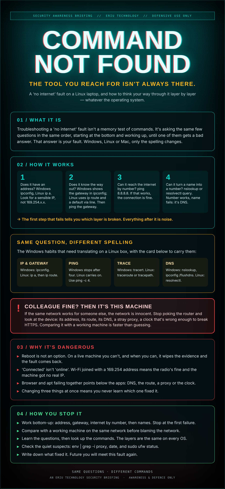

## Muscle memory, meet Linux

The interview question was simple enough. A user's Ubuntu laptop can't open any websites, and `apt update` fails too. The Wi-Fi says it's connected. A colleague on the same network is grand. You've a terminal in front of you — walk me through it.

My fingers went straight for `ipconfig`, with total confidence. Linux looked back at me and said *command not found*. Not an error I'd earned, exactly. Just the wrong dialect for the room I was standing in.

That's when it landed that the command was never the point. The commands change from one system to the next. The questions don't — and the questions are the bit worth learning.

## What it actually is

Troubleshooting a 'no internet' fault isn't a memory test of commands. It's asking the same few questions in the same order, starting at the bottom and working up, until one of them gets a bad answer. That answer is your fault. Windows, Linux or Mac, only the spelling changes.

## How it works

1. **Does it have an address?** Windows `ipconfig`, Linux `ip a`. Look for a sensible IP, not 169.254.x.x.
2. **Does it know the way out?** Windows shows the gateway in `ipconfig`; Linux uses `ip route` and a `default via` line. Then ping the gateway.
3. **Can it reach the internet by number?** `ping 8.8.8.8`. If that works, the connection is fine.
4. **Can it turn a name into a number?** `nslookup` or `resolvectl query`. Number works, name fails: it's DNS.

→ The first step that fails tells you which layer is broken. Everything after it is noise.

## Same question, different spelling

The Windows habits that need translating on a Linux box, with the card below to carry them:

- **IP & gateway** — Windows: ipconfig. Linux: ip a, then ip route.
- **Ping** — Windows stops after four. Linux carries on. Use ping -c 4.
- **Trace** — Windows: tracert. Linux: traceroute or tracepath.
- **DNS** — Windows: nslookup, ipconfig /flushdns. Linux: resolvectl.

## ⚠ Colleague fine? Then it's this machine

If the same network works for someone else, the network is innocent. Stop poking the router and look at the device: its address, its route, its DNS, a stray proxy, a clock that's wrong enough to break HTTPS. Comparing it with a working machine is faster than guessing.

## Why it's dangerous

- **Reboot is not an option.** On a live machine you can't, and when you can, it wipes the evidence and the fault comes back.
- **'Connected' isn't 'online'.** Wi-Fi joined with a 169.254 address means the radio's fine and the machine got no real IP.
- **Browser and apt failing together** points below the apps: DNS, the route, a proxy or the clock.
- **Changing three things at once** means you never learn which one fixed it.

## How you stop it

- **Work bottom-up:** address, gateway, internet by number, then names. Stop at the first failure.
- **Compare with a working machine** on the same network before blaming the network.
- **Learn the questions, then look up the commands.** The layers are the same on every OS.
- **Check the quiet suspects:** `env | grep -i proxy`, `date`, and `sudo ufw status`.
- **Write down what fixed it.** Future you will meet this fault again.

---

*An Eriu Technology briefing. Awareness and defence only. Learn the questions; the commands you can always look up.*
