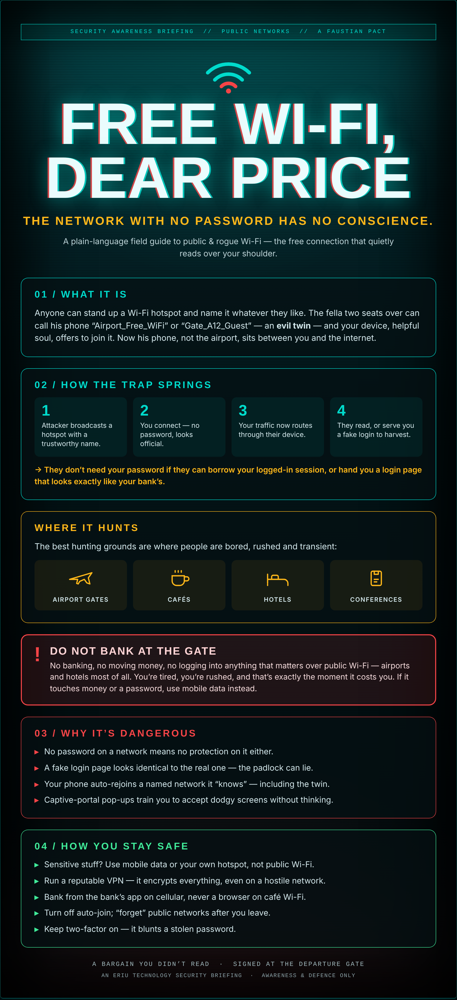

## A Faustian pact at the gate

The flight's delayed ninety minutes. You've a coffee going cold and nothing to do.

So you do what everyone does. You open the Wi-Fi list, see something called *Airport_Free_WiFi*, tap it, and you're on. No password, no fuss. And while you're there — sure, you'll just check the bank balance. Maybe move a few quid across to cover the holiday. Log into the work email while you're at it.

That's the bargain. Free connection now; you don't read the small print, because there isn't any. The devil doesn't hand you a contract at the departure gate. He just names a hotspot something you'll trust and waits for you to be bored enough to sign.

Because here's the thing nobody tells you: a Wi-Fi network is only a name and a signal, and **anyone can broadcast either**. The fella three seats down with a laptop in his bag can call his hotspot *Airport_Free_WiFi* just as easily as the airport can. Your phone can't tell the difference. It just sees a familiar name and joins — helpful to the last.

And the moment it does, his device is sitting in the middle of everything you send.

## The network you trust

We've trained ourselves to be wary of dodgy downloads and links. But most people treat Wi-Fi like tap water — if it's there, it's grand to drink. A network with no password *feels* convenient. What it actually means is there's no lock on the door, and no way to be sure whose door you walked through.

## What it actually is

The attack has a name: an **evil twin**. Someone stands up a hotspot with a trustworthy-sounding name — *Gate_A12_Guest*, *Hotel_WiFi_Free*, the café's actual name — and your device offers to join it like an old friend. Now that someone, not the airport, is the road every byte of your traffic travels down. In the trade it's a **man in the middle**: they're not breaking in, you're walking out to them.

## How the trap springs

1. The attacker broadcasts a hotspot with a name you'll trust.
2. You connect — no password, looks official, everyone else is on it too.
3. Your traffic now routes through their device instead of the real network.
4. They read what they can, or serve you a fake login page to harvest the rest.

And they often don't even need your password. If they can lift the logged-in *session* your browser is already holding, they walk straight in as you. Or they hand you a login screen that's a pixel-perfect copy of your bank's, and you type it in yourself.

## Why it's genuinely dangerous

- **No password, no protection.** An open network is open in both directions.
- **The padlock can lie.** A fake login page can show its own perfectly valid padlock. The lock proves the page is encrypted, not that it's honest.
- **Your phone is loyal to a fault.** Once it "knows" a network name it rejoins it automatically — including the twin, next time it's in range.
- **Captive portals train bad habits.** All those "accept the terms" pop-ups teach you to click through dodgy screens without a second look.

## ⚠ Do not bank at the gate

This is the one to tattoo on the inside of your eyelids. No banking, no moving money, no logging into anything that matters over public Wi-Fi — airports and hotels above all. You're tired, you're rushed, and that is precisely the moment the bargain comes due. If what you're about to do touches money or a password, come off the Wi-Fi and use mobile data instead. Thirty seconds of 4G is cheaper than a drained account.

## Where it hunts

The best hunting grounds are wherever people are bored, rushed and passing through: **airport gates**, **cafés**, **hotels**, and **conferences**. Lots of strangers, lots of devices, nobody staying long enough to ask questions, and everyone expecting free Wi-Fi to just be there. Perfect cover.

## How you stay safe

None of this means living in fear of a coffee shop. It means a few simple habits:

- **Sensitive = your own connection.** Banking, work logins, anything with money — do it on mobile data or your own personal hotspot, not public Wi-Fi.
- **Run a VPN.** A reputable VPN encrypts everything you send, so even a hostile network just sees scrambled noise.
- **Use the app, on cellular.** Bank from the bank's own app over mobile data, never a browser on café Wi-Fi.
- **Turn off auto-join** and "forget" public networks when you leave, so your phone won't quietly rejoin a twin later.
- **Keep two-factor on.** If a password does leak, 2FA is the bolt that still holds the door.

---

*An Eriu Technology security briefing. This is an awareness piece — concept, risk and defence only. The goal is to make the free network feel a little less free, so the next time you're bored at a gate, you keep your banking off it.*
