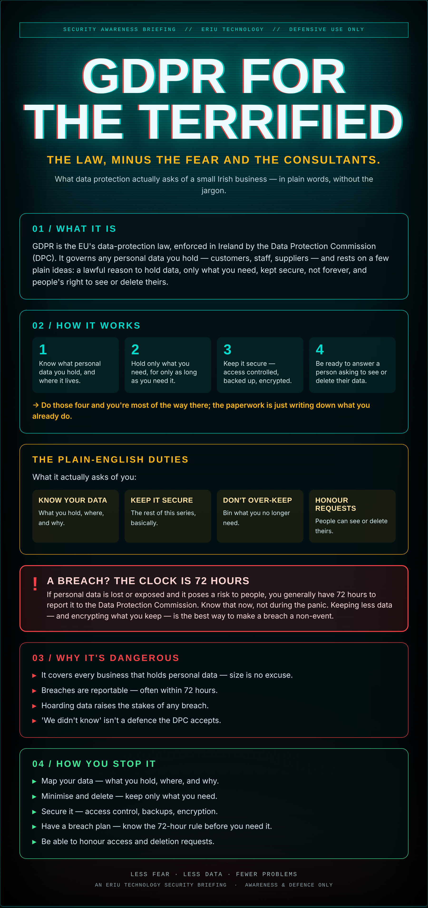

## It's mostly common sense

The letters 'GDPR' tend to land like a solicitor's letter: vaguely threatening, probably expensive, best not thought about. So most small businesses don't — until something goes wrong.

Here's the reassuring bit. For an ordinary small business, GDPR isn't a maze — it's mostly common sense written down: know what personal data you hold, keep it safe, don't hoard it forever, and be straight with people about it.

You don't need a consultant and a ring-binder. You need to know where the data is and treat it like it matters — because to the person it's about, it does.

## What it actually is

GDPR is the EU's data-protection law, enforced in Ireland by the Data Protection Commission (DPC). It governs any personal data you hold — customers, staff, suppliers — and rests on a few plain ideas: a lawful reason to hold data, only what you need, kept secure, not forever, and people's right to see or delete theirs.

## How it works

1. Know what personal data you hold, and where it lives.
2. Hold only what you need, for only as long as you need it.
3. Keep it secure — access controlled, backed up, encrypted.
4. Be ready to answer a person asking to see or delete their data.

→ Do those four and you're most of the way there; the paperwork is just writing down what you already do.

## The plain-English duties

What it actually asks of you:

- **Know your data** — What you hold, where, and why.
- **Keep it secure** — The rest of this series, basically.
- **Don't over-keep** — Bin what you no longer need.
- **Honour requests** — People can see or delete theirs.

## ⚠ A breach? The clock is 72 hours

If personal data is lost or exposed and it poses a risk to people, you generally have 72 hours to report it to the Data Protection Commission. Know that now, not during the panic. Keeping less data — and encrypting what you keep — is the best way to make a breach a non-event.

## Why it's dangerous

- **It covers every business** that holds personal data — size is no excuse.
- **Breaches are reportable** — often within 72 hours.
- **Hoarding data raises the stakes** of any breach.
- **'We didn't know' isn't a defence** the DPC accepts.

## How you stop it

- **Map your data** — what you hold, where, and why.
- **Minimise and delete** — keep only what you need.
- **Secure it** — access control, backups, encryption.
- **Have a breach plan** — know the 72-hour rule before you need it.
- **Be able to honour** access and deletion requests.

---

*An Eriu Technology security briefing. Awareness and defence only. Not legal advice — but enough to stop GDPR being the thing you're afraid to look at.*
