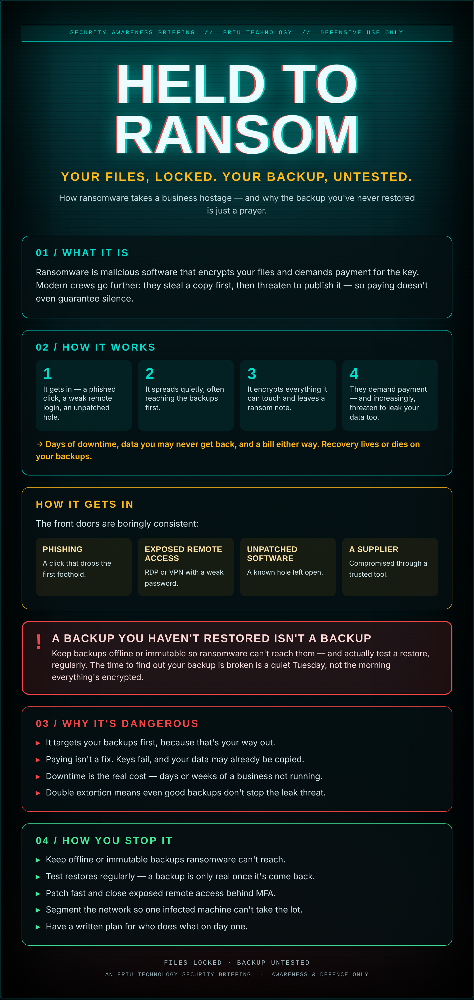

## The worst Monday

You come in on Monday and every file is gibberish. On the desktop, a note: your data is encrypted, pay to get it back.

You're grand, you think — there's a backup. Then you go to restore it and find it stopped running in March, or it's encrypted too, or nobody ever actually tried bringing it back. That's the real gut-punch.

Ransomware doesn't just lock your files. It bets that your backup is a box nobody's opened in a year.

## What it actually is

Ransomware is malicious software that encrypts your files and demands payment for the key. Modern crews go further: they steal a copy first, then threaten to publish it — so paying doesn't even guarantee silence.

## How it works

1. It gets in — a phished click, a weak remote login, an unpatched hole.
2. It spreads quietly, often reaching the backups first.
3. It encrypts everything it can touch and leaves a ransom note.
4. They demand payment — and increasingly, threaten to leak your data too.

→ Days of downtime, data you may never get back, and a bill either way. Recovery lives or dies on your backups.

## How it gets in

The front doors are boringly consistent:

- **Phishing** — A click that drops the first foothold.
- **Exposed remote access** — RDP or VPN with a weak password.
- **Unpatched software** — A known hole left open.
- **A supplier** — Compromised through a trusted tool.

## ⚠ A backup you haven't restored isn't a backup

Keep backups offline or immutable so ransomware can't reach them — and actually test a restore, regularly. The time to find out your backup is broken is a quiet Tuesday, not the morning everything's encrypted.

## Why it's dangerous

- **It targets your backups first**, because that's your way out.
- **Paying isn't a fix.** Keys fail, and your data may already be copied.
- **Downtime is the real cost** — days or weeks of a business not running.
- **Double extortion** means even good backups don't stop the leak threat.

## How you stop it

- **Keep offline or immutable backups** ransomware can't reach.
- **Test restores regularly** — a backup is only real once it's come back.
- **Patch fast** and close exposed remote access behind MFA.
- **Segment the network** so one infected machine can't take the lot.
- **Have a written plan** for who does what on day one.

---

*An Eriu Technology security briefing. Awareness and defence only. The difference between a bad week and a dead business is a backup you've actually tested.*
