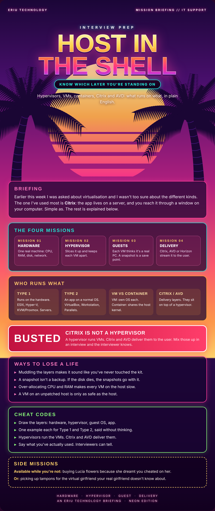

## Earlier this week

Earlier this week I was asked about virtualisation, and I wasn't too sure about the different kinds. I could have bluffed it. I'd rather learn it properly.

The one I've used most is **Citrix**. In a government institution that means the app lives on a server, and you reach it through a window on your computer. Simple as.

Citrix is only one layer of the story, though. The rest, and what sits on what, is explained below.

## What it actually is

Virtualisation is one physical machine pretending to be several. Everything else in this post is a question about layers: what sits on the hardware, who owns the operating system, and who just delivers the screen to the user.

## How it works

1. **Hardware does the work.** One real machine with its CPU, RAM, disk and network.
2. **A hypervisor slices it up.** It gives each virtual machine its own share and keeps them apart.
3. **Each VM thinks it's a real PC.** Its own guest OS, its own apps. A snapshot is a save point.
4. **A delivery layer reaches the user.** Citrix, AVD or Horizon stream the desktop or app to whatever device they're on.

→ Hypervisors run the VMs. Citrix and AVD deliver them. Different layers, different jobs.

## Who runs what

Four things people mix up:

- **Type 1** — Runs on the hardware. ESXi, Hyper-V, KVM/Proxmox. Servers.
- **Type 2** — Runs as an app on a normal OS. VirtualBox, Workstation, Parallels.
- **VM vs container** — VM: its own OS each. Container: shares the host kernel (Docker).
- **Citrix / AVD** — Delivery layers. They sit on top of a hypervisor.

## ⚠ Citrix is not a hypervisor

A hypervisor runs virtual machines. Citrix and AVD deliver desktops and apps to users, running on top of one. Citrix does sell a hypervisor, but when a support team says Citrix they mean the delivery layer. Mix those up in an interview and the interviewer knows.

## Why it's dangerous

- **Muddling the layers** makes it sound like you've never touched the kit, even when you have.
- **A snapshot isn't a backup.** If the disk dies, the snapshots go with it.
- **Over-allocating CPU and RAM** makes every VM on the host slow, not just one.
- **A VM on an unpatched host** is only as safe as the host underneath it.

## How you stop it

- **Draw the layers:** hardware, hypervisor, guest OS, app. Say who owns each one.
- **Learn Type 1 and Type 2 with one example each,** and say them without thinking.
- **Keep one line in your head:** hypervisors run the VMs, Citrix and AVD deliver them.
- **Say what you've actually used,** and what you only know in theory. Interviewers can tell.
- **Carry the card.** It's at the bottom of this page and fits in a wallet.

---

*An Eriu Technology briefing. Awareness and defence only. Draw the layers and you won't muddle them again.*
