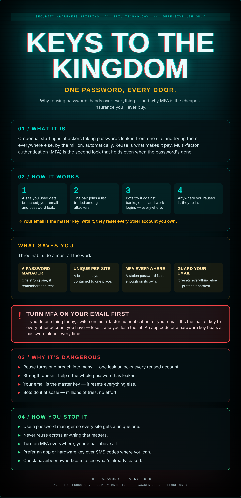

## The spare key under every mat

You've one good password. A fierce one. Capital letter, a number, a symbol. And you use it everywhere, because who could remember twenty of the things.

Then one of those twenty sites gets breached — some forum you forgot you joined in 2015 — and your email and that password end up on a list. Now someone tries the pair on your bank, your email, your work login. It only has to fit one lock.

The problem was never the password's strength. It was the spare key under every mat.

## What it actually is

Credential stuffing is attackers taking passwords leaked from one site and trying them everywhere else, by the million, automatically. Reuse is what makes it pay. Multi-factor authentication (MFA) is the second lock that holds even when the password's gone.

## How it works

1. A site you used gets breached; your email and password leak.
2. The pair joins a list traded among attackers.
3. Bots try it against banks, email and work logins — everywhere.
4. Anywhere you reused it, they're in.

→ Your email is the master key: with it, they reset every other account you own.

## What saves you

Three habits do almost all the work:

- **A password manager** — One strong one; it remembers the rest.
- **Unique per site** — A breach stays contained to one place.
- **MFA everywhere** — A stolen password isn't enough on its own.
- **Guard your email** — It resets everything else — protect it hardest.

## ⚠ Turn MFA on your email first

If you do one thing today, switch on multi-factor authentication for your email. It's the master key to every other account you have — lose it and you lose the lot. An app code or a hardware key beats a password alone, every time.

## Why it's dangerous

- **Reuse turns one breach into many** — one leak unlocks every reused account.
- **Strength doesn't help** if the whole password has leaked.
- **Your email is the master key** — it resets everything else.
- **Bots do it at scale** — millions of tries, no effort.

## How you stop it

- **Use a password manager** so every site gets a unique one.
- **Never reuse** across anything that matters.
- **Turn on MFA everywhere**, your email above all.
- **Prefer an app or hardware key** over SMS codes where you can.
- **Check haveibeenpwned.com** to see what's already leaked.

---

*An Eriu Technology security briefing. Awareness and defence only. A password manager and MFA cost almost nothing and stop the most common break-in there is.*
