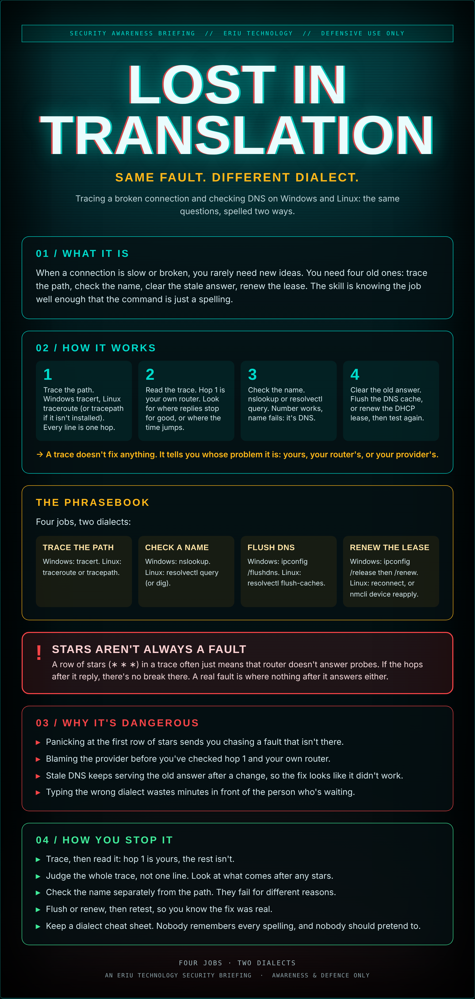

## The other half of the answer

After the `ipconfig` mishap I did what any sensible person does: wrote the dialects down. Turns out I only ever learned half of each answer. I knew the Windows command, and I knew what it was for. I just didn't know what it was called anywhere else.

So here's the next page of the phrasebook. Tracing a path, checking a name, clearing an old answer, renewing a lease. Four jobs you'll do in every support role, and every one has a Windows spelling and a Linux spelling.

The jobs don't change. Only the words do.

## What it actually is

When a connection is slow or broken, you rarely need new ideas. You need four old ones: trace the path, check the name, clear the stale answer, renew the lease. The skill is knowing the job well enough that the command is just a spelling.

## How it works

1. **Trace the path.** Windows `tracert`, Linux `traceroute` (or `tracepath` if it isn't installed). Every line is one hop.
2. **Read the trace.** Hop 1 is your own router. Look for where replies stop for good, or where the time jumps.
3. **Check the name.** `nslookup` or `resolvectl query`. Number works, name fails: it's DNS.
4. **Clear the old answer.** Flush the DNS cache, or renew the DHCP lease, then test again.

→ A trace doesn't fix anything. It tells you whose problem it is: yours, your router's, or your provider's.

## The phrasebook

Four jobs, two dialects:

- **Trace the path** — Windows: tracert. Linux: traceroute or tracepath.
- **Check a name** — Windows: nslookup. Linux: resolvectl query (or dig).
- **Flush DNS** — Windows: ipconfig /flushdns. Linux: resolvectl flush-caches.
- **Renew the lease** — Windows: ipconfig /release then /renew. Linux: reconnect, or nmcli device reapply.

## ⚠ Stars aren't always a fault

A row of stars (∗ ∗ ∗) in a trace often just means that router doesn't answer probes. If the hops after it reply, there's no break there. A real fault is where nothing after it answers either.

## Why it's dangerous

- **Panicking at the first row of stars** sends you chasing a fault that isn't there.
- **Blaming the provider** before you've checked hop 1 and your own router.
- **Stale DNS** keeps serving the old answer after a change, so the fix looks like it didn't work.
- **Typing the wrong dialect** wastes minutes in front of the person who's waiting.

## How you stop it

- **Trace, then read it:** hop 1 is yours, the rest isn't.
- **Judge the whole trace,** not one line. Look at what comes after any stars.
- **Check the name separately** from the path. They fail for different reasons.
- **Flush or renew, then retest,** so you know the fix was real.
- **Keep a dialect cheat sheet.** Nobody remembers every spelling, and nobody should pretend to.

---

*An Eriu Technology briefing. Awareness and defence only. Know the job, then look up the spelling.*
