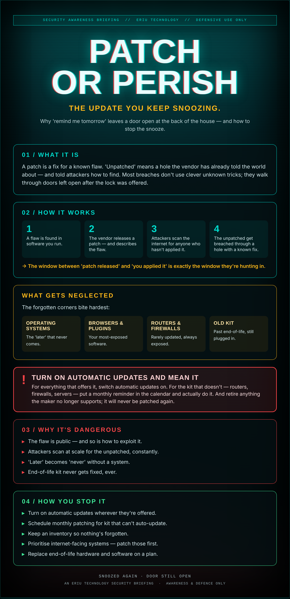

## 'Later' means never

The little banner appears again. Updates available. You're mid-task, so you hit 'later.' You've been hitting 'later' for a month.

Here's what 'later' means: when a software maker releases a security update, they also publish what it fixes. Attackers read that same note and go hunting for everyone who hasn't applied it yet. The patch and the attack arrive together.

An unpatched system isn't a secret weakness. It's a published one — with your name not yet on the list of people who closed it.

## What it actually is

A patch is a fix for a known flaw. 'Unpatched' means a hole the vendor has already told the world about — and told attackers how to find. Most breaches don't use clever unknown tricks; they walk through doors left open after the lock was offered.

## How it works

1. A flaw is found in software you run.
2. The vendor releases a patch — and describes the flaw.
3. Attackers scan the internet for anyone who hasn't applied it.
4. The unpatched get breached through a hole with a known fix.

→ The window between 'patch released' and 'you applied it' is exactly the window they're hunting in.

## What gets neglected

The forgotten corners bite hardest:

- **Operating systems** — The 'later' that never comes.
- **Browsers & plugins** — Your most-exposed software.
- **Routers & firewalls** — Rarely updated, always exposed.
- **Old kit** — Past end-of-life, still plugged in.

## ⚠ Turn on automatic updates and mean it

For everything that offers it, switch automatic updates on. For the kit that doesn't — routers, firewalls, servers — put a monthly reminder in the calendar and actually do it. And retire anything the maker no longer supports; it will never be patched again.

## Why it's dangerous

- **The flaw is public** — and so is how to exploit it.
- **Attackers scan at scale** for the unpatched, constantly.
- **'Later' becomes 'never'** without a system.
- **End-of-life kit** never gets fixed, ever.

## How you stop it

- **Turn on automatic updates** wherever they're offered.
- **Schedule monthly patching** for kit that can't auto-update.
- **Keep an inventory** so nothing's forgotten.
- **Prioritise internet-facing systems** — patch those first.
- **Replace end-of-life hardware and software** on a plan.

---

*An Eriu Technology security briefing. Awareness and defence only. Most break-ins use a hole that was fixed months ago — don't be the one who hit 'later.'*
