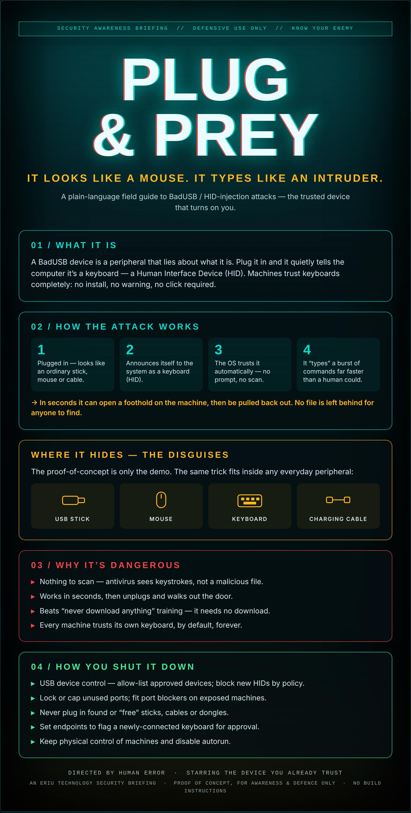

## Curiosity and the car-park USB

Here's a thought to ruin your afternoon.

You find a USB stick on the ground outside work. No label — or worse, a label that's just a little too tempting. *Payroll.* *Private.* *Do Not Share.* You're only human. You want to know. So you carry it inside, sit down, and slot it into the machine in front of you. The work machine.

Now let's say you work for Bank of Ireland. Or a mortgage crowd. Or, God forbid, somewhere medical — where the thing at the far end of that network is a stranger's diagnosis, their test results, the worst day of their life sitting in a database.

How fucked are you, exactly?

Fairly. You weren't careless with a file, because there was no file. You didn't click a bad link, because there was no link. You plugged in what looked like a stick and your computer, being a trusting soul, decided it was a keyboard and let it type whatever it liked, faster than you could blink. By the time you've pulled it out and told yourself you'll say nothing, the damage is done and there's nothing for the scanner to even find.

And the thing is — this isn't a hypothetical I dreamed up to frighten you.

One of my actual jobs, for a stretch, was walking back and forth between the various buildings of the Bundestag. The German parliament. And part of that walk, every single day, was collecting USB sticks. Off window ledges, out of toilets, down the side of chairs, in the car park. Six or seven a day, easy. Every one of them went straight in the bin. Not into a laptop to "see who it belongs to." The bin.

Towards the end I started wearing a glove to pick them up. Half because I'd a notion some of them might be dosed with something — acid, whatever your paranoid brain offers you at 7am — and half because once you've done the job long enough you stop seeing a lost gadget and start seeing bait. Because that's what most of them were. Nobody loses six sticks a day by accident in a parliament. Somebody's leaving them.

So the next time you find one and feel that little itch of *I wonder* — remember that the whole attack is built on exactly that itch. The stick isn't lost. You're the one being found.

## The device you already trust

Most security advice is about things you download: dodgy attachments, dodgy links, dodgy installers. So we train people not to click. Fair enough.

But there's a whole class of attack that never asks you to download a thing. It walks in the front door disguised as something you plug in every day — a memory stick, a mouse, a keyboard, even a charging cable — and your computer welcomes it without a word. It's called **BadUSB**, or an **HID-injection attack**, and this is the plain-English version of how it works and how you stop it.

## What it actually is

A BadUSB device is a peripheral that lies about what it is.

You plug it in, and instead of behaving like the mouse or stick it appears to be, it quietly tells the computer: *"I'm a keyboard."* In the trade that's a **Human Interface Device**, or HID. And here's the catch that makes the whole thing work — machines trust keyboards completely. No install. No warning. No click. A keyboard is assumed to be a human being typing, and humans are allowed to do anything.

## How the attack works

It's four beats, and it's quick:

1. **Plugged in.** It looks like an ordinary stick, mouse or cable. Nothing to see.
2. **It announces itself** to the system as a keyboard.
3. **The OS trusts it automatically** — no prompt, no scan, no question asked.
4. **It "types"** a burst of commands far faster than any human could.

In a few seconds it can open a foothold on the machine and then be pulled straight back out. There's no malicious file sitting on the disk afterwards — just a record of some keystrokes, if anyone even looks.

## Why it's genuinely nasty

- **There's nothing to scan.** Antivirus looks for malicious files. This isn't a file — it's keystrokes. There's nothing for the scanner to catch.
- **It's fast, then it's gone.** Seconds to run, then unplugged and out the door.
- **It beats "never download anything" training.** The whole attack needs no download, so the usual advice doesn't touch it.
- **The trust is permanent and built-in.** Every machine trusts its own keyboard, by default, forever. That's not a bug you can patch away — it's how computers are meant to work.

## Where it hides — the disguises

The flashy proof-of-concept gadget is only the demo. The same trick fits inside anything you'd plug in without thinking:

- a **USB memory stick**
- a **mouse**
- a **keyboard**
- a **charging or data cable**

If it plugs into a USB port, assume it *could* be one of these. The "found a USB stick in the car park" trope is a cliché precisely because it keeps working.

## How you shut it down

The good news: the defences are practical and mostly about policy and habit, not magic.

- **USB device control.** Allow-list the devices you approve, and block new HIDs by policy. This is the big one.
- **Lock down the ports.** Cap or physically block unused USB ports on exposed or public-facing machines; port blockers are cheap.
- **Never plug in strays.** No found sticks, no "free" cables at a conference, no mystery dongles. Ever.
- **Flag new keyboards.** Configure endpoints to prompt for approval when a brand-new keyboard suddenly appears.
- **Physical control and autorun off.** Keep machines where people can't quietly plug things in, and disable autorun.

---

*An Eriu Technology security briefing. This is an awareness piece — concept, risk and defence only. It contains no build instructions, and it's here so people recognise the attack and lock it out, not reproduce it.*
