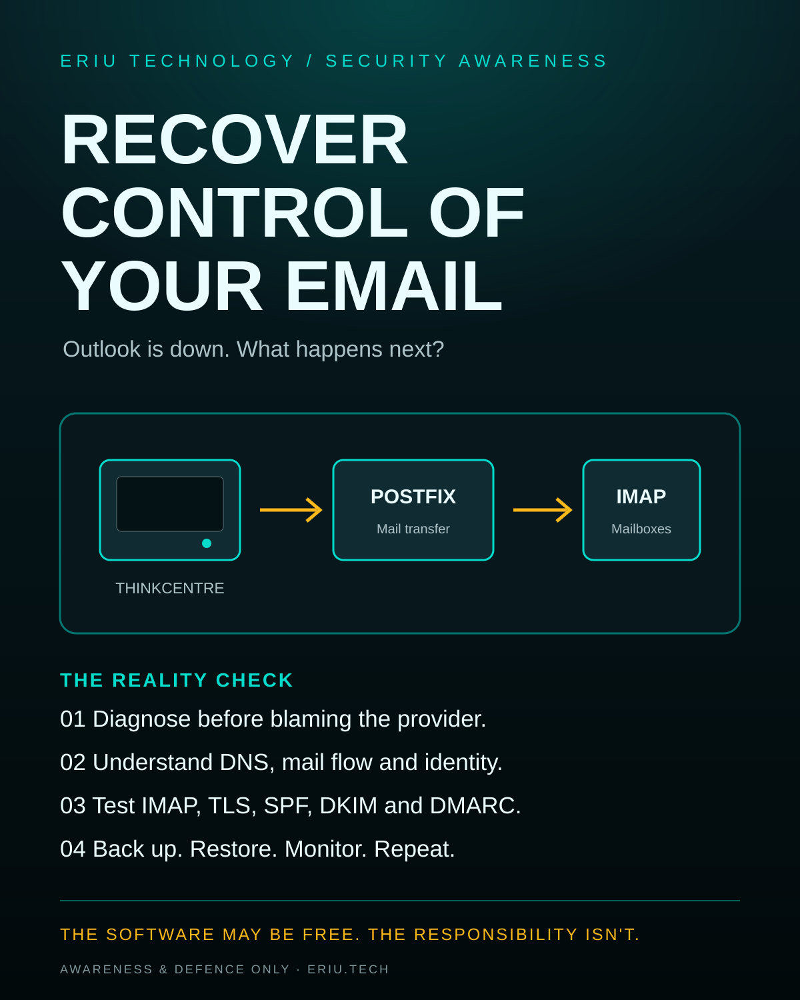
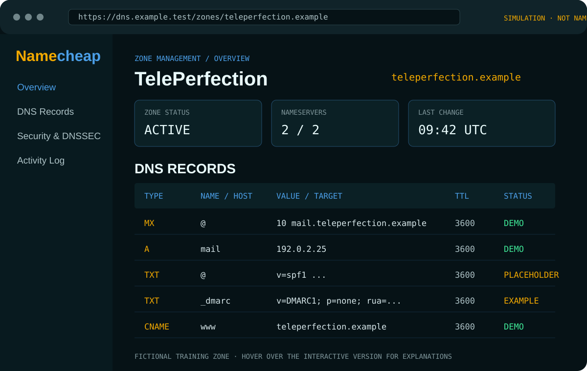

# Recover Control of Your Email

**Outlook has stopped working. One hundred and five people are waiting. Somewhere under a desk, an unloved Lenovo ThinkCentre is about to get a second career.**

A practical Eriu Technology case study about diagnosing email failure, understanding mail infrastructure, and building a controlled Linux mail-server lab.

## The short version

- Diagnose the outage before deciding Microsoft is at fault.
- Understand the roles of the domain, DNS, identity and hosted mail platform.
- Build a lab with Ubuntu Server, Postfix, Dovecot and Rspamd.
- Use IMAP for synchronised mailboxes across devices.
- Configure TLS, SPF, DKIM and DMARC carefully.
- Test backups and restores, not just whether services start.

## Important boundary

The ThinkCentre M920q Tiny (Core i7-8700T, 16GB RAM, 512GB SSD) is a suitable learning and portfolio machine. It is not a single-server production design for 105 employees. Use a controlled test domain; do not change live company DNS or route real mail without explicit authorisation and a proper resilience plan.

See the [full illustrated report](index.html) and the [interactive fictional Namecheap-style DNS dashboard](dns-console.html), with hover explanations for the records and controls.

