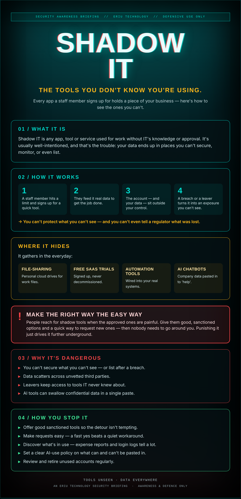

## Nobody meant any harm

Someone in accounts needed to share a big file, so they grabbed a free account on a site they'd heard of. Someone in sales wired the CRM into a handy little automation tool. Neither asked. Neither meant any harm.

Now bits of your business — client lists, invoices, documents — live in a scatter of apps you've never heard of, secured by passwords you don't control, run by companies you've never vetted. When one of them gets breached, it's your data in the leak.

Shadow IT isn't people being bold. It's people trying to get work done — and quietly building a map of your business you can't see.

## What it actually is

Shadow IT is any app, tool or service used for work without IT's knowledge or approval. It's usually well-intentioned, and that's the trouble: your data ends up in places you can't secure, monitor, or even list.

## How it works

1. A staff member hits a limit and signs up for a quick tool.
2. They feed it real data to get the job done.
3. The account — and your data — sit outside your control.
4. A breach or a leaver turns it into an exposure you can't see.

→ You can't protect what you can't see — and you can't even tell a regulator what was lost.

## Where it hides

It gathers in the everyday:

- **File-sharing** — Personal cloud drives for work files.
- **Free SaaS trials** — Signed up, never decommissioned.
- **Automation tools** — Wired into your real systems.
- **AI chatbots** — Company data pasted in to 'help'.

## ⚠ Make the right way the easy way

People reach for shadow tools when the approved ones are painful. Give them good, sanctioned options and a quick way to request new ones — then nobody needs to go around you. Punishing it just drives it further underground.

## Why it's dangerous

- **You can't secure what you can't see** — or list after a breach.
- **Data scatters** across unvetted third parties.
- **Leavers keep access** to tools IT never knew about.
- **AI tools** can swallow confidential data in a single paste.

## How you stop it

- **Offer good sanctioned tools** so the detour isn't tempting.
- **Make requests easy** — a fast yes beats a quiet workaround.
- **Discover what's in use** — expense reports and login logs tell a lot.
- **Set a clear AI-use policy** on what can and can't be pasted in.
- **Review and retire** unused accounts regularly.

---

*An Eriu Technology security briefing. Awareness and defence only. Shadow IT is a symptom — fix the friction that causes it and most of it disappears.*
