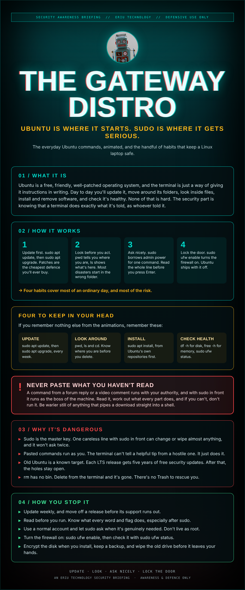

## The gateway drug

Ubuntu is the gateway drug. Somebody you love has an old laptop that's barely clinging on, and you can't bring yourself to bin it. So you swap the hard drive for an SSD, put Ubuntu on it, and ten minutes later it boots faster than the day it was bought. You're in. You are now the family IT department, unpaid.

There's a prettier cousin too, elementary OS, which is Linux wearing a Mac costume. I couldn't remember its name for a good five minutes and kept calling it 'the pretty one'. Underneath, it speaks exactly the same dialect.

Then one day the friendly icons run out and somebody says *just open a terminal*. Good news: you need about a dozen commands, and I've animated the lot. The catch, and the reason this is on a security blog, is that every one of them runs with *your* authority. Learn the commands, and learn which ones to treat with respect.

## What it actually is

Ubuntu is a free, friendly, well-patched operating system, and the terminal is just a way of giving it instructions in writing. Day to day you'll update it, move around its folders, look inside files, install and remove software, and check it's healthy. None of that is hard. The security part is knowing that a terminal does exactly what it's told, as whoever told it.

## How it works

1. **Update first.** `sudo apt update`, then `sudo apt upgrade`. Patches are the cheapest defence you'll ever buy.
2. **Look before you act.** `pwd` tells you where you are, `ls` shows what's here. Most disasters start in the wrong folder.
3. **Ask nicely.** `sudo` borrows admin power for one command. Read the whole line before you press Enter.
4. **Lock the door.** `sudo ufw enable` turns the firewall on. Ubuntu ships with it off.

→ Four habits cover most of an ordinary day, and most of the risk.

## Four to keep in your head

If you remember nothing else from the animations, remember these:

- **Update** — sudo apt update, then sudo apt upgrade, every week.
- **Look around** — pwd, ls and cd. Know where you are before you delete.
- **Install** — sudo apt install, from Ubuntu's own repositories first.
- **Check health** — df -h for disk, free -h for memory, sudo ufw status.

## ⚠ Never paste what you haven't read

A command from a forum reply or a video comment runs with your authority, and with sudo in front it runs as the boss of the machine. Read it, work out what every part does, and if you can't, don't run it. Be warier still of anything that pipes a download straight into a shell.

## Why it's dangerous

- **Sudo is the master key.** One careless line with sudo in front can change or wipe almost anything, and it won't ask twice.
- **Pasted commands run as you.** The terminal can't tell a helpful tip from a hostile one. It just does it.
- **Old Ubuntu is a known target.** Each LTS release gets five years of free security updates. After that, the holes stay open.
- **rm has no bin.** Delete from the terminal and it's gone. There's no Trash to rescue you.

## How you stop it

- **Update weekly,** and move off a release before its support runs out.
- **Read before you run.** Know what every word and flag does, especially after sudo.
- **Use a normal account** and let sudo ask when it's genuinely needed. Don't live as root.
- **Turn the firewall on:** `sudo ufw enable`, then check it with `sudo ufw status`.
- **Encrypt the disk when you install,** keep a backup, and wipe the old drive before it leaves your hands.

---

*An Eriu Technology briefing. Awareness and defence only. The terminal is a very good servant and a very literal one.*
