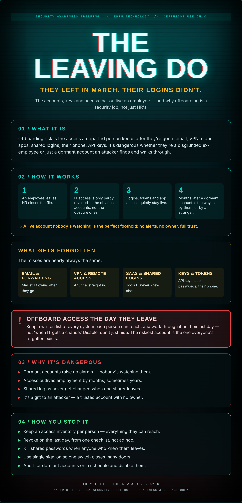

## Cake, cards, and a door left open

Someone leaves on good terms. Cake in the kitchen, a card, handshakes. Their desk is cleared by Friday.

Six months on, their email still forwards, their VPN still connects, their login to the shared drive still works, and the SaaS tool nobody remembers they set up still bills your card. Every one of those is an unlocked door with nobody watching it.

Most offboarding tidies the desk and forgets the digital keys. Those keys don't retire — they just sit there.

## What it actually is

Offboarding risk is the access a departed person keeps after they're gone: email, VPN, cloud apps, shared logins, their phone, API keys. It's dangerous whether they're a disgruntled ex-employee or just a dormant account an attacker finds and walks through.

## How it works

1. An employee leaves; HR closes the file.
2. IT access is only partly revoked — the obvious accounts, not the obscure ones.
3. Logins, tokens and app access quietly stay live.
4. Months later a dormant account is the way in — by them, or by a stranger.

→ A live account nobody's watching is the perfect foothold: no alerts, no owner, full trust.

## What gets forgotten

The misses are nearly always the same:

- **Email & forwarding** — Mail still flowing after they go.
- **VPN & remote access** — A tunnel straight in.
- **SaaS & shared logins** — Tools IT never knew about.
- **Keys & tokens** — API keys, app passwords, their phone.

## ⚠ Offboard access the day they leave

Keep a written list of every system each person can reach, and work through it on their last day — not 'when IT gets a chance.' Disable, don't just hide. The riskiest account is the one everyone's forgotten exists.

## Why it's dangerous

- **Dormant accounts raise no alarms** — nobody's watching them.
- **Access outlives employment** by months, sometimes years.
- **Shared logins never get changed** when one sharer leaves.
- **It's a gift to an attacker** — a trusted account with no owner.

## How you stop it

- **Keep an access inventory** per person — everything they can reach.
- **Revoke on the last day**, from one checklist, not ad hoc.
- **Kill shared passwords** when anyone who knew them leaves.
- **Use single sign-on** so one switch closes many doors.
- **Audit for dormant accounts** on a schedule and disable them.

---

*An Eriu Technology security briefing. Awareness and defence only. A good leaving-do ends with the cake — and with every one of their keys turned off.*
