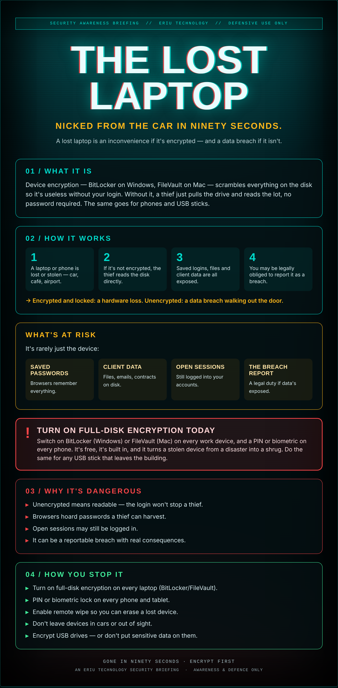

## Twenty minutes, one broken window

The laptop's in the boot for twenty minutes while you grab a coffee. You come back and the window's gone in. So's the bag.

If that laptop was encrypted and locked, you've lost a few hundred quid of hardware and a bad afternoon. If it wasn't, you've lost every file on it, every saved password in the browser, and possibly a reportable data breach — to whoever now owns it.

The difference between a shrug and a catastrophe is one setting you turn on once and forget.

## What it actually is

Device encryption — BitLocker on Windows, FileVault on Mac — scrambles everything on the disk so it's useless without your login. Without it, a thief just pulls the drive and reads the lot, no password required. The same goes for phones and USB sticks.

## How it works

1. A laptop or phone is lost or stolen — car, café, airport.
2. If it's not encrypted, the thief reads the disk directly.
3. Saved logins, files and client data are all exposed.
4. You may be legally obliged to report it as a breach.

→ Encrypted and locked: a hardware loss. Unencrypted: a data breach walking out the door.

## What's at risk

It's rarely just the device:

- **Saved passwords** — Browsers remember everything.
- **Client data** — Files, emails, contracts on disk.
- **Open sessions** — Still logged into your accounts.
- **The breach report** — A legal duty if data's exposed.

## ⚠ Turn on full-disk encryption today

Switch on BitLocker (Windows) or FileVault (Mac) on every work device, and a PIN or biometric on every phone. It's free, it's built in, and it turns a stolen device from a disaster into a shrug. Do the same for any USB stick that leaves the building.

## Why it's dangerous

- **Unencrypted means readable** — the login won't stop a thief.
- **Browsers hoard passwords** a thief can harvest.
- **Open sessions** may still be logged in.
- **It can be a reportable breach** with real consequences.

## How you stop it

- **Turn on full-disk encryption** on every laptop (BitLocker/FileVault).
- **PIN or biometric lock** on every phone and tablet.
- **Enable remote wipe** so you can erase a lost device.
- **Don't leave devices in cars** or out of sight.
- **Encrypt USB drives** — or don't put sensitive data on them.

---

*An Eriu Technology security briefing. Awareness and defence only. Encryption is free and built in; it's the one setting that turns stolen hardware into just stolen hardware.*
