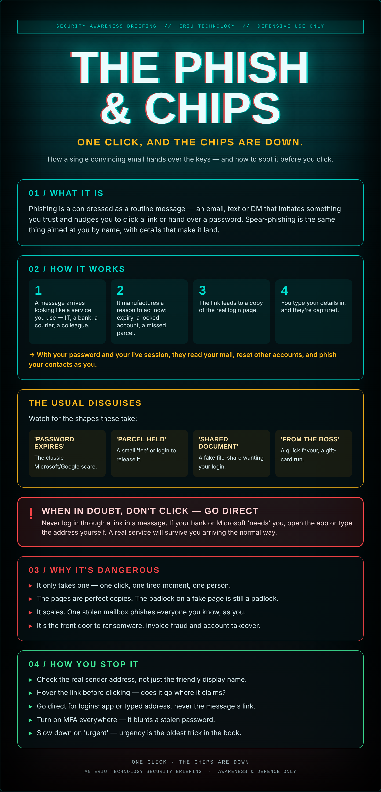

## Caught on a busy Tuesday

It's a Tuesday, you're twelve emails deep, and one says your Microsoft password expires today. Click here to keep your account.

The page looks right. The logo's right. You type your password, it says 'done,' and you move on with your day. So does the person now reading your mailbox.

Phishing isn't about being gullible. It's about being busy, and being caught at the right moment with the right-looking email.

## What it actually is

Phishing is a con dressed as a routine message — an email, text or DM that imitates something you trust and nudges you to click a link or hand over a password. Spear-phishing is the same thing aimed at you by name, with details that make it land.

## How it works

1. A message arrives looking like a service you use — IT, a bank, a courier, a colleague.
2. It manufactures a reason to act now: expiry, a locked account, a missed parcel.
3. The link leads to a copy of the real login page.
4. You type your details in, and they're captured.

→ With your password and your live session, they read your mail, reset other accounts, and phish your contacts as you.

## The usual disguises

Watch for the shapes these take:

- **'Password expires'** — The classic Microsoft/Google scare.
- **'Parcel held'** — A small 'fee' or login to release it.
- **'Shared document'** — A fake file-share wanting your login.
- **'From the boss'** — A quick favour, a gift-card run.

## ⚠ When in doubt, don't click — go direct

Never log in through a link in a message. If your bank or Microsoft 'needs' you, open the app or type the address yourself. A real service will survive you arriving the normal way.

## Why it's dangerous

- **It only takes one** — one click, one tired moment, one person.
- **The pages are perfect copies.** The padlock on a fake page is still a padlock.
- **It scales.** One stolen mailbox phishes everyone you know, as you.
- **It's the front door** to ransomware, invoice fraud and account takeover.

## How you stop it

- **Check the real sender address**, not just the friendly display name.
- **Hover the link** before clicking — does it go where it claims?
- **Go direct** for logins: app or typed address, never the message's link.
- **Turn on MFA** everywhere — it blunts a stolen password.
- **Slow down on 'urgent'** — urgency is the oldest trick in the book.

---

*An Eriu Technology security briefing. Awareness and defence only. The cure isn't being clever — it's slowing down for the two seconds it takes to check.*
