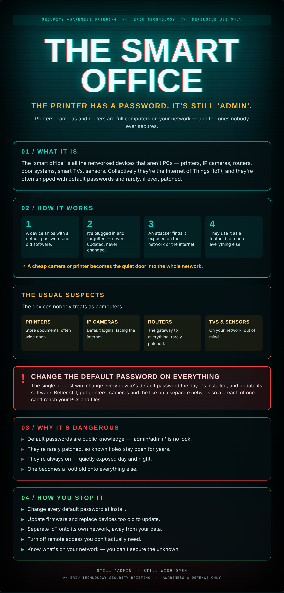

## The kettle has Wi-Fi now

Nobody thinks of the office printer as a computer. Or the security camera, or the router, or the smart TV in the meeting room. They're just… things that work.

But every one of them is a little computer on your network, often with a default password still set to 'admin,' software last updated the day it was made, and a direct line to everything else you own. Attackers love them precisely because nobody's looking.

You locked the laptops and forgot the kettle had Wi-Fi. That's the soft underbelly.

## What it actually is

The 'smart office' is all the networked devices that aren't PCs — printers, IP cameras, routers, door systems, smart TVs, sensors. Collectively they're the Internet of Things (IoT), and they're often shipped with default passwords and rarely, if ever, patched.

## How it works

1. A device ships with a default password and old software.
2. It's plugged in and forgotten — never updated, never changed.
3. An attacker finds it exposed on the network or the internet.
4. They use it as a foothold to reach everything else.

→ A cheap camera or printer becomes the quiet door into the whole network.

## The usual suspects

The devices nobody treats as computers:

- **Printers** — Store documents, often wide open.
- **IP cameras** — Default logins, facing the internet.
- **Routers** — The gateway to everything, rarely patched.
- **TVs & sensors** — On your network, out of mind.

## ⚠ Change the default password on everything

The single biggest win: change every device's default password the day it's installed, and update its software. Better still, put printers, cameras and the like on a separate network so a breach of one can't reach your PCs and files.

## Why it's dangerous

- **Default passwords** are public knowledge — 'admin/admin' is no lock.
- **They're rarely patched**, so known holes stay open for years.
- **They're always on** — quietly exposed day and night.
- **One becomes a foothold** onto everything else.

## How you stop it

- **Change every default password** at install.
- **Update firmware** and replace devices too old to update.
- **Separate IoT onto its own network**, away from your data.
- **Turn off remote access** you don't actually need.
- **Know what's on your network** — you can't secure the unknown.

---

*An Eriu Technology security briefing. Awareness and defence only. If it's on your network and it has a password, it's a computer — treat it like one.*
