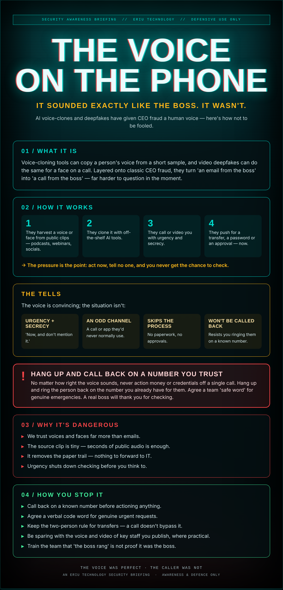

## A call you'd never question

The phone rings. It's your managing director — the voice, the turns of phrase, the slight impatience. There's a deal closing, it's sensitive, they need a transfer done in the next hour and they can't get to a computer.

Everything about the voice is right, because it was built from thirty seconds of them talking on a podcast, a webinar, a video on the company site. You weren't careless. You were played by a very good forgery.

We've learned to doubt a strange email. We haven't learned to doubt a familiar voice. That's the gap this attack lives in.

## What it actually is

Voice-cloning tools can copy a person's voice from a short sample, and video deepfakes can do the same for a face on a call. Layered onto classic CEO fraud, they turn 'an email from the boss' into 'a call from the boss' — far harder to question in the moment.

## How it works

1. They harvest a voice or face from public clips — podcasts, webinars, socials.
2. They clone it with off-the-shelf AI tools.
3. They call or video you with urgency and secrecy.
4. They push for a transfer, a password or an approval — now.

→ The pressure is the point: act now, tell no one, and you never get the chance to check.

## The tells

The voice is convincing; the situation isn't:

- **Urgency + secrecy** — 'Now, and don't mention it.'
- **An odd channel** — A call or app they'd never normally use.
- **Skips the process** — No paperwork, no approvals.
- **Won't be called back** — Resists you ringing them on a known number.

## ⚠ Hang up and call back on a number you trust

No matter how right the voice sounds, never action money or credentials off a single call. Hang up and ring the person back on the number you already have for them. Agree a team 'safe word' for genuine emergencies. A real boss will thank you for checking.

## Why it's dangerous

- **We trust voices and faces** far more than emails.
- **The source clip is tiny** — seconds of public audio is enough.
- **It removes the paper trail** — nothing to forward to IT.
- **Urgency shuts down checking** before you think to.

## How you stop it

- **Call back on a known number** before actioning anything.
- **Agree a verbal code word** for genuine urgent requests.
- **Keep the two-person rule** for transfers — a call doesn't bypass it.
- **Be sparing with the voice and video** of key staff you publish, where practical.
- **Train the team** that 'the boss rang' is not proof it was the boss.

---

*An Eriu Technology security briefing. Awareness and defence only. The forgery is good enough now that the only safe answer is to hang up and check — every time.*
