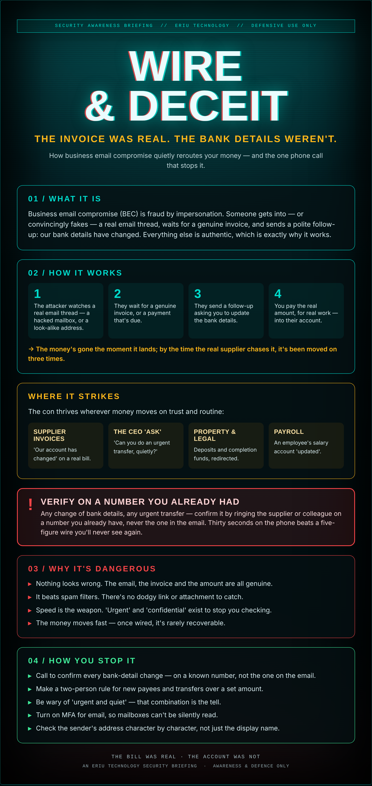

## A bill you were always going to pay

The invoice lands from a supplier you've paid a hundred times. Same logo, same layout, same amount. Only the account number at the bottom is new.

You pay it. Why wouldn't you — it's a supplier you know, for work that was actually done. Three weeks later the real supplier rings looking for their money, and that's when the floor opens.

No virus, no hacker in a hoodie. Just an email that looked exactly like it should, and a bank account that belonged to someone else.

## What it actually is

Business email compromise (BEC) is fraud by impersonation. Someone gets into — or convincingly fakes — a real email thread, waits for a genuine invoice, and sends a polite follow-up: *our bank details have changed.* Everything else is authentic, which is exactly why it works.

## How it works

1. The attacker watches a real email thread — a hacked mailbox, or a look-alike address.
2. They wait for a genuine invoice, or a payment that's due.
3. They send a follow-up asking you to update the bank details.
4. You pay the real amount, for real work — into their account.

→ The money's gone the moment it lands; by the time the real supplier chases it, it's been moved on three times.

## Where it strikes

The con thrives wherever money moves on trust and routine:

- **Supplier invoices** — 'Our account has changed' on a real bill.
- **The CEO 'ask'** — 'Can you do an urgent transfer, quietly?'
- **Property & legal** — Deposits and completion funds, redirected.
- **Payroll** — An employee's salary account 'updated'.

## ⚠ Verify on a number you already had

Any change of bank details, any urgent transfer — confirm it by ringing the supplier or colleague on a number you already have, never the one in the email. Thirty seconds on the phone beats a five-figure wire you'll never see again.

## Why it's dangerous

- **Nothing looks wrong.** The email, the invoice and the amount are all genuine.
- **It beats spam filters.** There's no dodgy link or attachment to catch.
- **Speed is the weapon.** 'Urgent' and 'confidential' exist to stop you checking.
- **The money moves fast** — once wired, it's rarely recoverable.

## How you stop it

- **Call to confirm every bank-detail change** — on a known number, not the one on the email.
- **Make a two-person rule** for new payees and transfers over a set amount.
- **Be wary of 'urgent and quiet'** — that combination is the tell.
- **Turn on MFA** for email, so mailboxes can't be silently read.
- **Check the sender's address** character by character, not just the display name.

---

*An Eriu Technology security briefing. Awareness and defence only. The whole con rests on you not picking up the phone — so pick up the phone.*
