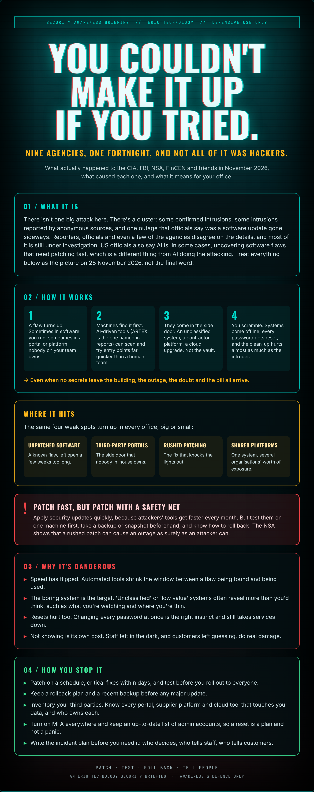

## One bad week, lined up

You know the way a bad week in the office looks like a dozen unrelated problems? The printer's down, somebody's locked out, the accounts package is crawling, and then someone lines the dates up on a whiteboard and it turns out they're all connected. Or, as it sometimes turns out, they're not, and you've spent a day blaming the wrong thing.

That was the American government's fortnight. The CIA, the FBI, the Air Force, the Treasury and the Department of Agriculture all had incidents land within days of each other, and the NSA's network fell over for good measure. The headlines read like a thriller. The detail reads more like an IT department having a very long month.

So here are all nine, one at a time, with what's confirmed, what's only reported, and what actually caused it. The lesson is about your office, not theirs: **the unglamorous stuff, patching, passwords and forgotten side doors, is where the damage starts.**

## What it actually is

There isn't one big attack here. There's a cluster: some confirmed intrusions, some intrusions reported by anonymous sources, and one outage that officials say was a software update gone sideways. Reporters, officials and even a few of the agencies disagree on the details, and most of it is still under investigation. US officials also say AI is, in some cases, uncovering software flaws that need patching fast, which is a different thing from AI doing the attacking. Treat everything below as the picture on 28 November 2026, not the final word.

## The nine, one by one

The Open-Source Intelligence System isn't an agency in its own right. It's the shared system at the heart of the CIA story, so it gets its own entry. Everything here is sourced from news reports; where something is unconfirmed, it says so.

**1. US Air Force.** Reuters reported on 27 November, citing three people familiar with the matter (five sources in all, every one anonymous), that hackers had breached Cloud One, the Air Force's flagship cloud platform. It was found within the past month or so during work to upgrade the system. The fallout paused efforts to move back-office applications onto it, blocked updates to apps already running (so staff couldn't apply fixes just as a new batch of serious software vulnerabilities was disclosed), and left some users with their administrator rights revoked. One source said the intruders exploited a software vulnerability to reach the platform's control plane, which they likened to a universal remote. Reuters couldn't identify the vulnerability, the hackers, the full scope, or whether anything was stolen. The Air Force said it doesn't comment on the security of specific networks, and investigators have reportedly called in Cyber Command to assess the damage.

**2. Central Intelligence Agency.** The New York Times reported on 24 November, citing U.S. officials and other people familiar with the matter, that the CIA and at least two other spy agencies had found a breach that exposed some of their unclassified information. It affected an open-source intelligence analysis system, and the sources said classified material was not jeopardised. What exactly was exposed isn't clear. Some of the sources said the attackers were believed to have used ARTEX, an AI hacking tool a Chinese engineer released in July. Investigators don't know who is responsible, though two sources said early signs, including the use of ARTEX, suggest China may be behind it. Beijing routinely denies such allegations. The CIA declined to comment, and how the attackers got in hasn't been reported.

**3. Federal Bureau of Investigation.** CNN reported around 20 November, citing two people briefed on it, that the FBI was investigating an apparent breach of the National Crime Information Center, the database police across the US use to check warrants and background checks. It's the second such FBI breach in recent months. In September a group called ShinyHunters hit an FBI jobs website and went after employee personal data. Nextgov says Donald Trump and other officials have since acknowledged the NCIC hack. How the intruders got in, and what they took, hasn't been made public. Jay Clayton, the Director of National Intelligence, said on 23 November that breaches happen often and there's no cause for alarm. A former FBI cybercrime investigator told CNN his worry isn't only access: it's whether hackers could compromise the accuracy of the records officers rely on. That is a concern, not something reported to have happened.

**4. Office of the Director of National Intelligence.** ODNI shares the CIA's open-source system and was named alongside it. An ODNI official said there were no disruptions to critical capabilities or classified systems. The cause is the same as the CIA case: unknown entry route, suspected AI tooling, no confirmed culprit.

**5. National Geospatial-Intelligence Agency.** The Pentagon's mapping and imagery agency was named by the New York Times, according to two of its sources, as one of the agencies affected. NGA didn't respond to requests for comment, so its involvement hasn't been confirmed by the agency itself.

**6. The open-source intelligence system (OSINT).** This is the system, not a department. Analysts use it to find insights in public and commercially available material: news and social media, satellite imagery, and data sets bought from vendors. The Times notes that such purchased data can be highly revealing, especially when combined with other data. Nothing classified is in it, but the risk is subtler: someone inside may be able to see what analysts search for and track, which is a map of what US intelligence cares about and where it's looking thin. The same ARTEX tool was reportedly used in a separate low-impact intrusion at the Defense Department's Cyber Defense Command, though nobody has said the two are linked.

**7. US Department of Agriculture.** USDA's own security operations centre uncovered a security incident, according to an internal email dated 16 November, and a department employee later confirmed to the New York Times that some internal applications had been taken offline. Many applications went offline over several days, including the financial tools used to pay farmers and the screens showing loan and aid status. The department reset every database password in every environment, and because every application had to be reset to match, that is what caused the outages. Staff reportedly felt poorly informed. The cause of the intrusion, the culprit, and whether any data was taken have not been reported.

**8. Treasury: FinCEN.** The Financial Crimes Enforcement Network announced on 24 November that someone had gained unauthorised access to 'a limited subset' of its systems. It took some systems offline as a precaution, kept its Bank Secrecy Act filing portal running, and extended deadlines for affected filers. Investigators currently see no evidence that the main suspicious-activity reports database or the company-ownership database were breached. FinCEN hasn't said how the intruder got in, and no group has claimed it.

**9. National Security Agency.** This one wasn't a hack. On 17 November the NSA's internal classified network went down, staff were told to come in at staggered times, and the agency said it was 'temporary degradation during scheduled routine maintenance'. The Director of National Intelligence, Jay Clayton, said it came from patching software after a PHP vulnerability was found the month before, and that some systems didn't come back up as expected. Officials said there was no evidence of a cyberattack. Nextgov reports it resumed normal operations on Friday 20 November after a three-day disruption. The NSA stayed operational throughout, but it's still a good example of how a fix can break things.

## How it works

1. **A flaw turns up.** Sometimes in software you run, sometimes in a portal or platform nobody on your team owns.
2. **Machines find it first.** AI-driven tools (ARTEX is the one named in reports) can scan and try entry points far quicker than a human team.
3. **They come in the side door.** An unclassified system, a contractor platform, a cloud upgrade. Not the vault.
4. **You scramble.** Systems come offline, every password gets reset, and the clean-up hurts almost as much as the intruder.

→ Even when no secrets leave the building, the outage, the doubt and the bill all arrive.

## Where it hits

The same four weak spots turn up in every office, big or small:

- **Unpatched software** — A known flaw, left open a few weeks too long.
- **Third-party portals** — The side door that nobody in-house owns.
- **Rushed patching** — The fix that knocks the lights out.
- **Shared platforms** — One system, several organisations' worth of exposure.

## ⚠ Patch fast, but patch with a safety net

Apply security updates quickly, because attackers' tools get faster every month. But test them on one machine first, take a backup or snapshot beforehand, and know how to roll back. The NSA shows that a rushed patch can cause an outage as surely as an attacker can.

## Why it's dangerous

- **Speed has flipped.** Automated tools shrink the window between a flaw being found and being used.
- **The boring system is the target.** 'Unclassified' or 'low value' systems often reveal more than you'd think, such as what you're watching and where you're thin.
- **Resets hurt too.** Changing every password at once is the right instinct and still takes services down.
- **Not knowing is its own cost.** Staff left in the dark, and customers left guessing, do real damage.

## How you stop it

- **Patch on a schedule,** critical fixes within days, and test before you roll out to everyone.
- **Keep a rollback plan** and a recent backup before any major update.
- **Inventory your third parties.** Know every portal, supplier platform and cloud tool that touches your data, and who owns each.
- **Turn on MFA everywhere** and keep an up-to-date list of admin accounts, so a reset is a plan and not a panic.
- **Write the incident plan before you need it:** who decides, who tells staff, who tells customers.

## Sources

- [Reuters: Hackers breach US Air Force flagship Cloud One computing platform](https://www.reuters.com/world/hackers-breach-us-air-force-flagship-cloud-one-computing-platform-2026-11-27/)
- [BleepingComputer: US Air Force cloud platform reportedly hacked](https://www.bleepingcomputer.com/news/security/us-air-force-cloud-platform-reportedly-hacked-in-latest-federal-breach/)
- The New York Times (Volz, Pager and Barnes, 24 Nov 2026): U.S. Spy Agencies Suffer Breach of Some Unclassified Information
- [Nextgov: CIA, ODNI unclassified intelligence system hacked](https://www.nextgov.com/cybersecurity/2026/11/cia-odni-unclassified-intelligence-system-hacked/417438/)
- [Gizmodo: U.S. spying agencies reportedly hacked](https://gizmodo.com/u-s-spying-agencies-reportedly-hacked-2000845088)
- [CNN: Trump downplays breach into FBI's crime database](https://www.cnn.com/2026/11/20/politics/fbi-hacked-again-target-crime-database)
- [BleepingComputer: FBI reportedly hacked again, targeting NCIC](https://www.bleepingcomputer.com/news/security/fbi-reportedly-hacked-again-this-time-targeting-nationwide-police-database/)
- [Nextgov: USDA grapples with security breach](https://www.nextgov.com/cybersecurity/2026/11/usda-grapples-security-breach-it-staff-take-multiple-systems-offline/417350/)
- [The Record: Treasury's FinCEN takes systems offline](https://therecord.media/treasury-fincen-takes-systems-offline-after-cyber-incident)
- [Federal News Network: NSA classified network goes down](https://federalnewsnetwork.com/technology-main/2026/11/classified-communications-network-at-the-national-security-agency-goes-down-defense-official-says/)
- [SDxCentral: NSA outage after botched PHP update](https://www.sdxcentral.com/news/national-security-agency-subject-of-latest-network-outage-after-botched-php-update/)

---

*An Eriu Technology briefing. Awareness and defence only. The grown-ups have the same problems as the rest of us, just with bigger acronyms.*
